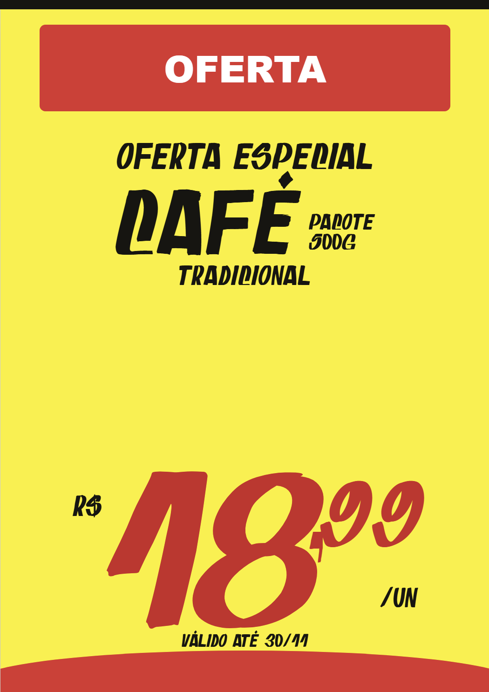

<div align="center">

# Cartaz Fácil

### Cartazes de supermercado com aparência profissional, prontos para imprimir.

Edite produtos, preços e datas em segundos. Calibre o conteúdo para papéis pré-impressos, salve modelos reutilizáveis e mantenha toda a operação offline.

[](LICENSE)
[](https://github.com/marcelomicucci/cartaz_supermercado/actions/workflows/ci.yml)
[](https://github.com/marcelomicucci/cartaz_supermercado/releases)
[](https://www.electronjs.org/)

[Baixar para Windows](https://github.com/marcelomicucci/cartaz_supermercado/releases/latest) · [Reportar problema](https://github.com/marcelomicucci/cartaz_supermercado/issues)

</div>



## Feito para a rotina do varejo

O Cartaz Fácil transforma o preenchimento manual de cartazes em um fluxo rápido e repetível. A equipe escolhe uma mídia, carrega um template, altera somente o produto, o preço ou a validade e imprime sobre o papel pré-impresso.

Tudo funciona localmente: não há conta, mensalidade, anúncios nem envio de dados para servidores.

## Recursos

- Editor visual com prévia em tempo real.
- Fonte promocional incluída no aplicativo.
- Cadastro de mídias com largura, altura e margens em milímetros.
- Biblioteca de templates reutilizáveis.
- Controle individual de tamanho para chamada, produto, detalhe, unidade, moeda, preço, centavos, sufixo e data.
- Posicionamento independente dos blocos de texto e preço.
- Calibração horizontal, vertical e de escala para cada impressora.
- Impressão do conteúdo sobre papéis pré-impressos, sem imprimir o fundo de referência.
- Persistência local de mídias, templates e último cartaz editado.
- Aplicativo desktop para Windows 10 e 11.

## Instalação

1. Acesse a página de [releases](https://github.com/marcelomicucci/cartaz_supermercado/releases/latest).
2. Baixe `CartazFacil-Setup.exe`.
3. Execute o instalador e abra **Cartaz Fácil** pelo Menu Iniciar.

O instalador ainda não possui assinatura digital. Por isso, o Windows pode exibir o aviso de editor desconhecido. Nesse caso, confira se o arquivo veio desta página, clique em **Mais informações** e depois em **Executar assim mesmo**.

## Primeiros passos

1. Abra **Mídias** e confira as dimensões do papel utilizado.
2. No **Editor**, informe produto, unidade, preço e validade.
3. Ajuste tamanhos e posições observando a prévia fixa.
4. Imprima primeiro em papel comum.
5. Sobreponha o teste ao papel pré-impresso contra a luz.
6. Corrija os deslocamentos em milímetros e repita até encaixar.
7. Salve a composição como template para as próximas ofertas.

Na janela de impressão, use escala de `100%`, desative cabeçalhos e rodapés e não selecione “ajustar à página”.

## Desenvolvimento

Requisitos: Node.js 22 ou superior e Windows para gerar o instalador Squirrel.

```powershell
git clone https://github.com/marcelomicucci/cartaz_supermercado.git
cd cartaz_supermercado
npm ci
npm start
```

Comandos disponíveis:

```powershell
npm run check       # valida a sintaxe do código
npm test            # executa o fluxo principal automaticamente
npm run screenshot  # atualiza a imagem de demonstração
npm run package     # gera o aplicativo portátil
npm run make        # gera o instalador Windows
```

O instalador é criado em `out/make/squirrel.windows/x64/`.

## Estrutura

```text
.
├── assets/          # fonte usada nos cartazes
├── docs/            # imagens da documentação
├── scripts/         # utilitários de manutenção
├── app.js           # estado, editor, mídias e templates
├── index.html       # interface
├── styles.css       # layout, cartazes e impressão
├── main.js          # janela desktop Electron
└── forge.config.js  # empacotamento para Windows
```

## Privacidade

O Cartaz Fácil não possui telemetria nem integração com serviços externos. Os dados são armazenados pelo Electron no perfil local do usuário. Remover o aplicativo não envia ou publica suas mídias e templates.

## Contribuindo

Sugestões, correções e novos modelos são bem-vindos. Consulte o [guia de contribuição](CONTRIBUTING.md) antes de abrir um pull request.

## Licença e créditos

O Cartaz Fácil pode ser usado, modificado e distribuído gratuitamente,
inclusive em projetos comerciais, sob a [licença BSD 3-Clause](LICENSE).

Redistribuições do código ou de aplicativos derivados devem preservar o aviso
de copyright e os créditos a **Marcelo Micucci — Cartaz Fácil**, conforme o
arquivo [CREDITS.md](CREDITS.md). A fonte `Oferta do Dia` integra este projeto
e segue os mesmos termos.

---

<div align="center">
Feito para quem precisa trocar a oferta antes que a fila chegue ao caixa.
</div>
